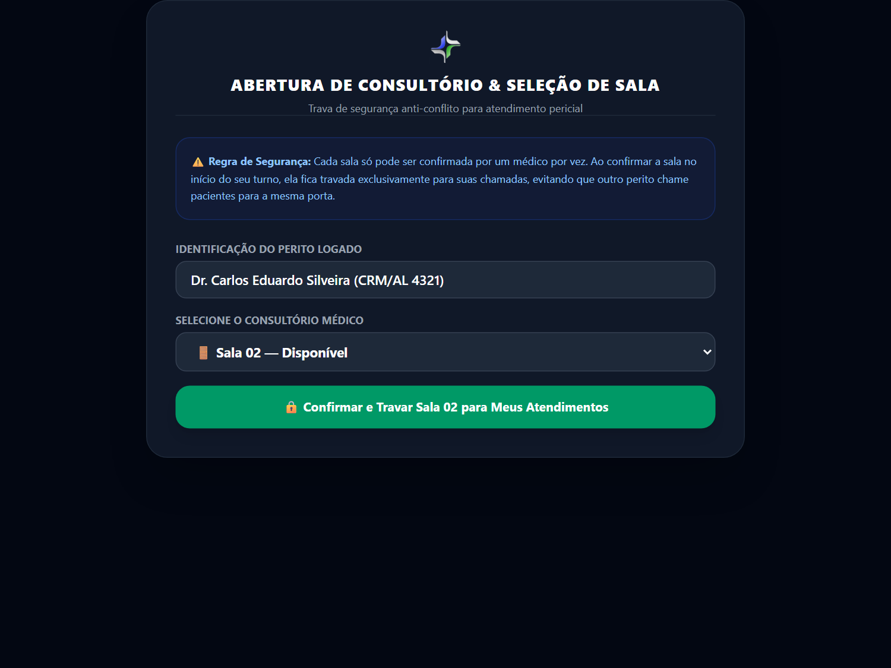
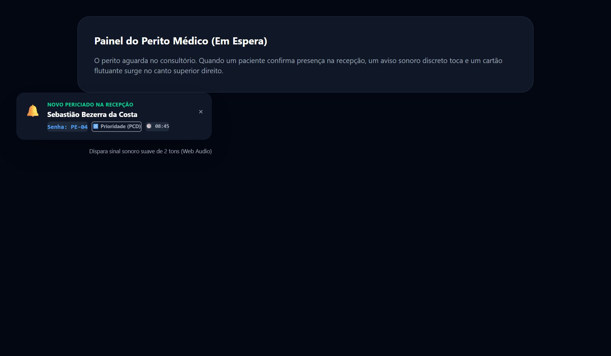
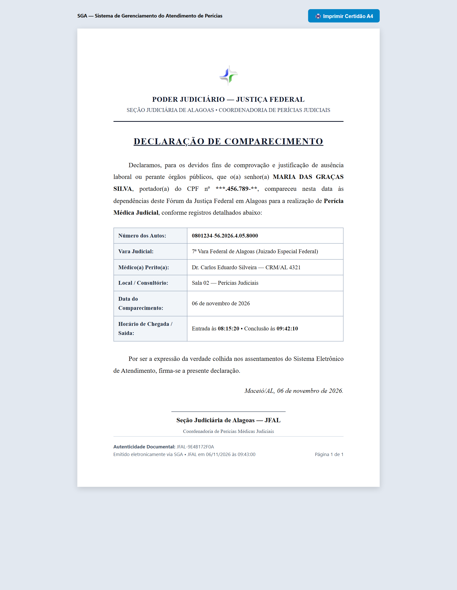

# Manual do Usuário — Painel do Médico Perito Judicial
### Sistema de Gerenciamento de Atendimento Pericial (SGA)
**Justiça Federal em Alagoas — Seção Judiciária de Alagoas**

---

## 1. Visão Geral e Finalidade

O módulo do **Médico Perito Judicial** no SGA foi projetado para oferecer agilidade, autonomia clínica e total transparência no fluxo de atendimento dos periciados dentro do consultório.

Principais recursos disponíveis para o perito:
1. **Seleção Segura de Consultório:** Vinculação da sala de exame com mecanismo inteligente de prevenção de conflitos entre peritos.
2. **Chamada Audiovisual na TV:** Acionamento de chamadas na sala de espera com toque sonoro de campainha e sintetização por voz do nome, senha e sala.
3. **Autonomia de Critério de Atendimento:** Escolha livre entre atender por **Ordem de Chegada** (balcão da recepção) ou pelo **Horário Marcado no PJe**.
4. **Gestão Flexível de Prioridades Legais:** Chave liga/desliga para priorizar pacientes 80+ (Superprioridade) e 60+/PCD no topo da fila, respeitando a conveniência do fluxo de trabalho do médico.
5. **Tolerância Inteligente de Ausência:** Reposiciona pacientes ausentes 2 posições para trás na fila, sem cancelamento da perícia.
6. **Notificações em Tempo Real:** Alertas sonoros suaves e notificações visuais (toasts) a cada novo paciente que faz check-in na recepção.
7. **Emissão Direta de Declaração de Comparecimento:** Impressão em 1 clique do comprovante oficial A4 direto do consultório.
8. **Liberação Automática de Sala:** Desvinculação imediata do consultório ao encerrar o expediente ou fazer logout.

---

## 2. Acesso e Seleção de Sala (Trava Anti-Conflito)

Ao acessar o sistema (`http://atendimento.jfal.jus.br`) com o usuário de médico perito, a primeira etapa é a definição do consultório físico onde as perícias serão realizadas.



### Regras de Vinculação de Sala:
- **Salas Livres:** Apresentam botão verde **Entrar na Sala**.
- **Salas Ocupadas:** Exibem uma tarja vermelha/âmbar indicando o colega perito que está atendendo no momento (ex: *"Ocupada pelo Dr. Roberto Souza"*). O botão fica desabilitado para impedir que dois peritos convoquem pacientes para o mesmo espaço físico simultaneamente.
- **Entrada no Consultório:** Selecione a sua sala (ex: `Sala 02 — Perícias Médicas`) e clique em **Entrar na Sala**.

> [!NOTE]
> Se você precisar trocar de sala durante o expediente, não é necessário fazer logout: basta clicar no botão **Trocar de Sala** no topo do painel.

---

## 3. Painel Principal do Consultório Pericial

Uma vez dentro da sala, o perito visualiza o painel operacional de atendimento:


### Componentes da Interface:

#### A. Barra Superior do Consultório
- **Identificação da Sala:** Exibe a sala ativa (ex: `🚪 Sala 02 — Consultório Pericial`).
- **Botão Liberar Sala:** Libera o consultório no sistema sem encerrar a sessão do usuário.
- **Botão Sair:** Encerra a sessão e desocupa automaticamente o consultório.

#### B. Alternadores de Regras da Fila (Autonomia do Perito)
Localizados logo abaixo do cabeçalho, esses botões definem a inteligência de ordenação dos seus pacientes:

1. **Critério da Fila (Chegada vs Horário PJe):**
   - **🏃 Ordem de Chegada:** Os pacientes que já deram entrada na recepção são ordenados pelo horário do check-in físico. Ideal para evitar esperas prolongadas de quem chegou cedo.
   - **🕒 Horário PJe:** Reorganiza a fila dos presentes com base no horário oficial agendado na pauta do processo judicial. Ideal para peritos que preferem cumprir a agenda estrita do processo.

2. **Filtro de Prioridade Legal (Autonomia Médica):**
   - **🟢 Atender Prioridade Primeiro (Ativado):** O sistema puxa automaticamente os periciados com **Superprioridade (80+)** e **Prioridade Legal (60+, PCD, Gestantes)** para o topo da lista de espera.
   - **⚪ Atender pela Ordem Pura (Desativado):** O sistema não altera a ordem cronológica da fila (seja por chegada ou PJe), deixando a decisão de atendimento prioritário a critério do médico.

> [!IMPORTANT]
> A recepção e a supervisão conseguem visualizar em tempo real no dashboard qual critério você está utilizando, garantindo total transparência e alinhamento com os jurisdicionados.

---

## 4. Ciclo Completo de Atendimento Pericial

O ciclo de atendimento é simples, objetivo e controlado por três botões de ação:

```
[ 1. Chamar Paciente ]  ➔  [ 2. Iniciar Perícia ]  ➔  [ 3. Concluir Exame ]
      (Botão Azul)              (Botão Verde)               (Botão Roxo)
```

### Etapa 1: Chamar o Paciente
1. No card **Próximo da Fila**, verifique o nome, a senha e o número do processo do primeiro paciente da fila.
2. Clique no botão azul **🔔 Chamar Paciente**.
3. O sistema dispara a chamada para a TV da Sala de Espera:
   - A TV emite um sinal sonoro (gongo/campainha).
   - A voz sintetizada anuncia: *"Senha PE-01, Dr. Carlos Eduardo Silveira, Sala 02"*.
   - A tela da TV destaca o nome, processo e se há crachá de prioridade:


4. O status no seu painel passa para **Chamando...**. Caso o paciente demore a entrar, clique em **Chamar Novamente** para repetir o aviso sonoro na TV.

### Etapa 2: Iniciar o Exame Pericial
1. Quando o paciente adentrar o consultório, clique no botão verde **▶ Iniciar Perícia**.
2. O cronômetro do atendimento é acionado na tela.
3. O painel da recepção e o dashboard da supervisão são atualizados simultaneamente com a informação: `🟢 Dr. Carlos: Em Exame (PE-01)`.

### Etapa 3: Concluir o Atendimento
1. Ao finalizar a anamnese, o exame físico e os apontamentos periciais, clique no botão roxo **✓ Concluir Atendimento**.
2. O paciente é registrado como atendido e o tempo total de perícia é contabilizado nos indicadores estatísticos da JFAL.
3. O próximo paciente da fila já assume o destaque no painel, pronto para ser chamado!

---

## 5. Ausência e Tolerância Inteligente (Descer 2 Posições)

Caso o perito chame o paciente repetidas vezes e ele não compareça à porta do consultório:

1. Clique no botão âmbar **⚠️ Ausente (Descer 2 posições)**.
2. **O que o sistema faz:**
   - Em vez de marcar falta definitiva ou cancelar a perícia (o paciente pode estar no banheiro ou ter se distraído), o SGA joga o periciado **duas posições para trás** na fila de quem já está presente no prédio.
   - O próximo periciado da fila avança para a primeira posição e já pode ser chamado.
   - O periciado ausente ganha uma nova oportunidade de ser atendido após mais duas consultas.

> [!TIP]
> Essa funcionalidade reduz atritos e cancelamentos desnecessários de perícias, garantindo a celeridade dos atos processuais sem prejudicar os demais cidadãos pontuais.

---

## 6. Notificações e Alertas em Tempo Real (Toast)

Durante a realização dos exames clínicos, você não precisa ficar atualizando a página para saber se os demais pacientes do dia estão chegando.



- A cada check-in efetuado pela recepção, o painel do médico emite um suave bipe sonoro.
- Um alerta flutuante (*toast*) surge discretamente no canto superior direito da tela:
  `Novo paciente na fila: Maria Helena Santos (Senha PE-04) acabou de chegar!`
- A tabela de fila de espera do perito se reorganiza automaticamente.

---

## 7. Emissão de Declaração de Comparecimento

Se o periciado ou seu advogado solicitar a comprovação de presença diretamente no consultório:



1. Localize o nome do paciente no card de atendimento atual ou no histórico de atendidos do dia.
2. Clique no ícone **📄 Declaração**.
3. O formulário em padrão oficial da JFAL será aberto com o nome do médico perito, número do processo e horários de entrada e saída já preenchidos.
4. Pressione `Ctrl + P` para enviar diretamente à impressora do consultório.

---

## 8. Encerramento do Expediente e Liberação de Sala

Ao terminar a pauta pericial do dia:
1. Verifique se todos os periciados presentes foram devidamente concluídos.
2. Clique no botão vermelho **Sair** no canto superior direito.
3. O sistema finaliza a sua sessão e **desocupa a sala de atendimento imediatamente no banco de dados**.
4. A sala fica liberada para que peritos do turno seguinte possam vinculá-la sem impedimentos.

---
*Manual homologado para o SGA JFAL — Seção Judiciária de Alagoas — Versão 2.4*
