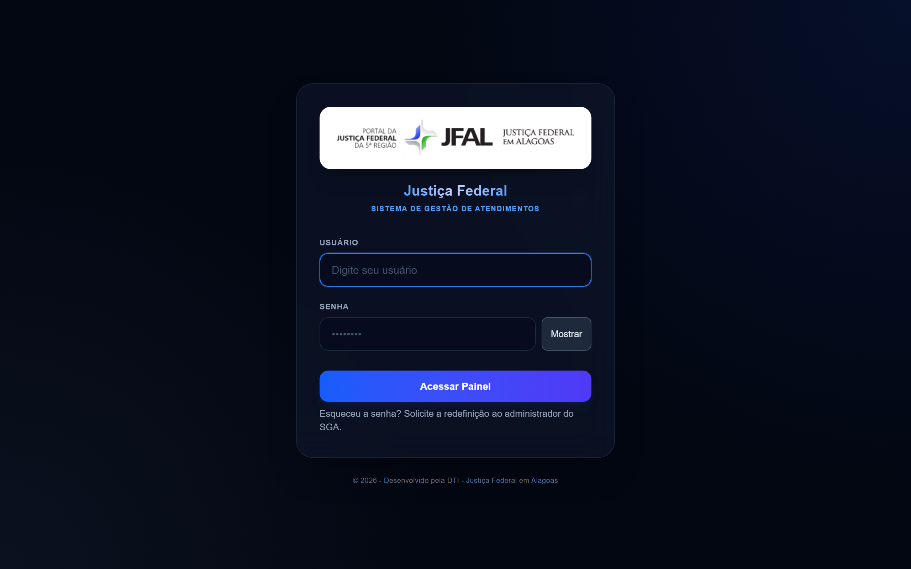
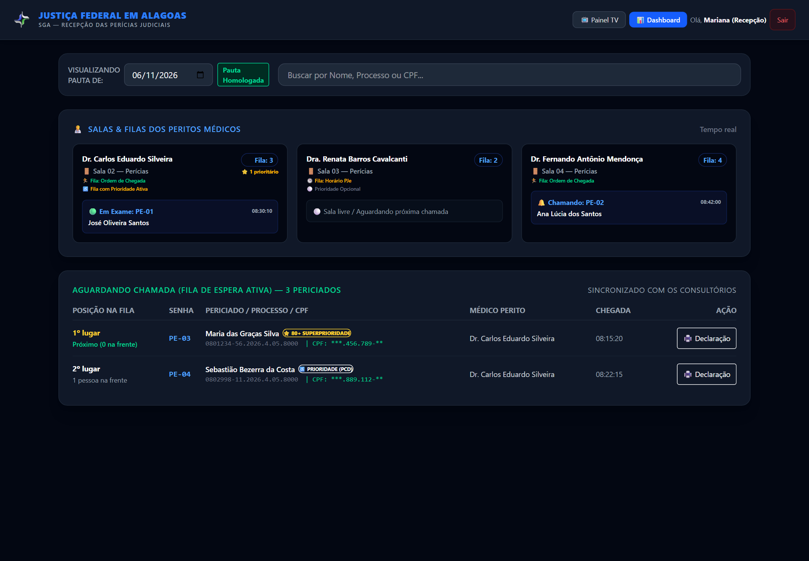
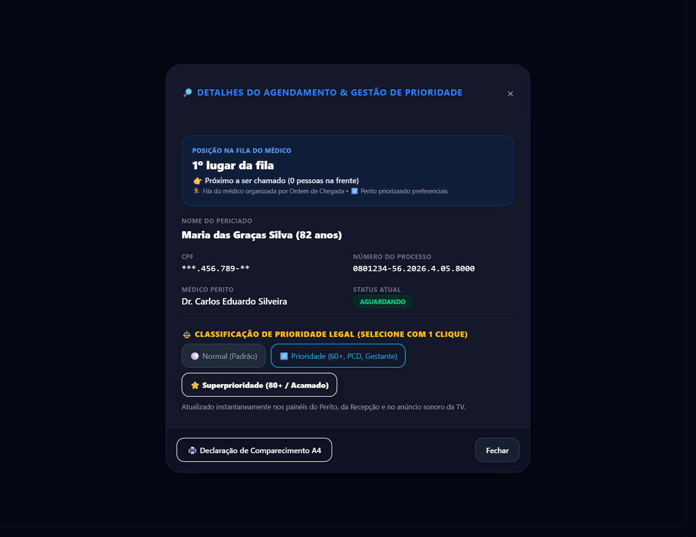
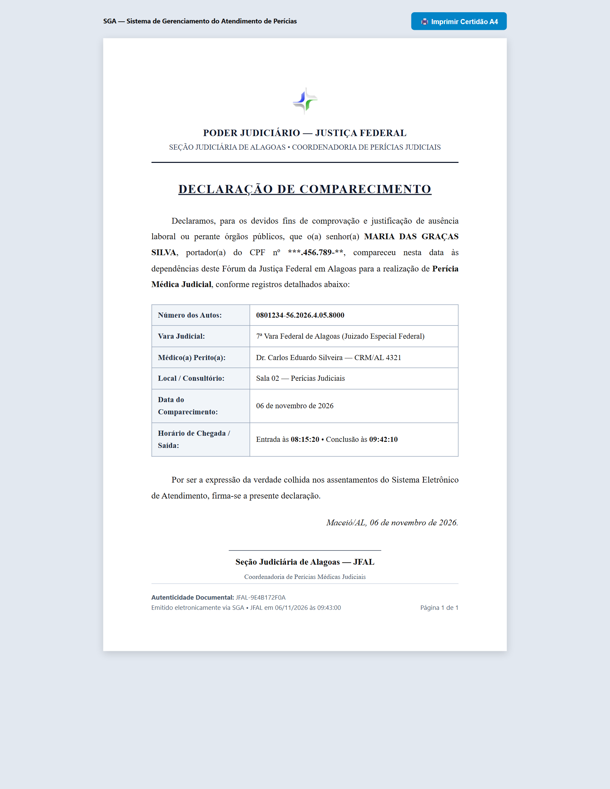

# Manual do Usuário — Módulo de Recepção e Triagem
### Sistema de Gerenciamento de Atendimento Pericial (SGA)
**Justiça Federal em Alagoas — Seção Judiciária de Alagoas**

---

## 1. Visão Geral e Finalidade

O módulo de **Recepção** do SGA é a porta de entrada dos cidadãos que comparecem ao Fórum da Justiça Federal para realização de perícias médicas judiciais. 

Suas principais funções operacionais incluem:
1. **Identificação e Check-in:** Localizar o processo e confirmar a presença física do periciado.
2. **Emissão de Senha:** Geração automática da senha de atendimento vinculada ao médico perito (`PE-01`, `PE-02`, etc.).
3. **Classificação de Prioridade Legal:** Identificar e registrar formalmente casos de prioridade (60+ anos, PCD, gestantes) e superprioridade (80+ anos).
4. **Orientação ao Jurisdicionado:** Informar com precisão a quantidade de pessoas que aguardam na frente na fila de cada consultório.
5. **Monitoramento em Tempo Real:** Acompanhar o status de cada sala médica (sala livre, perito chamando ou em exame).
6. **Emissão de Declaração de Comparecimento:** Emitir documento oficial em folha A4 para comprovação perante empregadores ou órgãos públicos.

---

## 2. Acesso ao Sistema e Autenticação

Para acessar o módulo de recepção:
1. Abra o navegador web (Google Chrome, Microsoft Edge ou Mozilla Firefox) no computador da recepção.
2. Acesse o endereço institucional do SGA: `http://atendimento.jfal.jus.br`.
3. Na tela de autenticação, insira seu usuário e senha institucionais.
4. Selecione o perfil **Recepção** (ou perfil atribuído pela DTI/Supervisão).

> [!TIP]
> Caso esqueça sua senha ou necessite de cadastramento de novos recepcionistas, solicite abertura de chamado junto à DTI ou ao Supervisor do SGA.

---

## 3. Navegação e Painel Principal da Recepção

Após o login, o operador é direcionado à tela principal da Recepção:

### 3.1. Barra de Ferramentas Superior
- **Logomarca da JFAL:** Identificação da seção judiciária.
- **📺 Painel TV:** Abre a tela do painel de chamadas da sala de espera em uma nova aba (ideal para projetar na TV da recepção).
- **📊 Dashboard:** Atalho para visualização das estatísticas gerais do dia.
- **Identificação do Usuário:** Exibe o nome do operador logado e o botão **Sair** (encerra a sessão com segurança).

### 3.2. Filtro de Data e Busca Rápida
- **Visualizando Pauta de:** Permite selecionar o dia da pauta. Por padrão, exibe a data corrente (`Hoje`). Pautas já liberadas para atendimento recebem a etiqueta verde `Pauta Homologada`.
- **Campo de Busca:** Digite qualquer trecho do **Nome do Periciado**, **Número do Processo Judicial** ou **CPF** para filtrar a listagem instantaneamente sem recarregar a página.

### 3.3. Cards de Salas e Filas dos Médicos Peritos
Na parte superior da tela, os cards apresentam o panorama ao vivo de cada consultório ativo:
- **Identificação do Médico e Sala:** Nome do perito e sala vinculada (ex: `Dr. Carlos Eduardo Silveira — Sala 02`).
- **Critério de Fila Ativo:**
  - `🏃 Fila: Ordem de Chegada`: O perito atende prioritariamente quem chegou primeiro ao fórum.
  - `🕒 Fila: Horário PJe`: O perito optou por seguir o horário oficial agendado na pauta judicial.
- **Status da Prioridade no Consultório:**
  - `♿ Fila com Prioridade Ativa`: O médico ativou o atendimento preferencial; pacientes prioritários e superprioritários vão ao topo da fila dele.
  - `⚪ Prioridade Opcional`: O médico está atendendo na ordem cronológica direta.
- **Contador de Espera:** Quantidade total de pessoas aguardando aquele médico e quantos são prioritários (ex: `Fila: 3 | ⭐ 1 prioritário`).
- **Estado Atual da Sala:**
  - `🟢 Em Exame: PE-01 (José Oliveira Santos)`: O perito está realizando o exame pericial.
  - `🔔 Chamando: PE-02 (Ana Lúcia dos Santos)`: O perito acionou o chamado na TV e aguarda a entrada do paciente.
  - `⚪ Sala livre`: Consultório desocupado aguardando o médico acionar o próximo da fila.

---

## 4. Procedimento de Check-in (Confirmação de Presença)

Ao chegar ao balcão, o cidadão deve apresentar seu documento oficial de identificação com foto e/ou número do processo.

### Passo a Passo:
1. **Localizar o Periciado:**
   - Localize o nome do periciado na seção **Agendados para o Dia**.
   - Dica: Utilize a barra de busca instantânea digitando os primeiros dígitos do CPF, parte do nome ou número do processo.
2. **Confirmar Dados:**
   - Confira o nome completo do periciado, o processo e o perito associado.
3. **Acionar a Confirmação Dinâmica (Sem Recarregar a Tela):**
   - Clique no botão destacado **✅ Confirmar Chegada**.
   - O sistema processa o check-in assincronamente (via AJAX): a linha sai com transição suave da tabela de agendados e entra na fila de espera, sem recarregar a página e preservando sua busca e rolagem.
4. **Emissão de Senha e Notificação Flutuante:**
   - Um alerta flutuante verde (toast) surge no canto superior direito confirmando a presença e exibindo com clareza a senha gerada (ex: `Presença confirmada: Carlos Santos. Senha: PE-04`).
5. **Orientação ao Cidadão:**
   - Informe a senha ao cidadão: *"Sua senha é PE-04 com o Dr. Carlos na Sala 02. Por favor, aguarde na sala de espera que seu nome e senha serão chamados na TV com sinal sonoro."*

---

## 5. Gestão de Prioridade Legal e Superprioridade

O SGA cumpre rigorosamente as normas federais de acessibilidade e prioridade de atendimento (Lei nº 10.048/2000, Lei nº 10.741/2003 - Estatuto da Pessoa Idosa, e Lei nº 13.466/2017).

### Categorias de Prioridade:
1. **Normal (Padrão):**
   - Atendimento regular seguindo a ordem cronológica de chegada ou horário marcado.
2. **Prioridade Legal (60+ Anos, PCD, Gestantes, Lactantes, Autistas):**
   - Destinada a pessoas idosas a partir de 60 anos, pessoas com deficiência, gestantes, lactantes e pessoas com mobilidade reduzida ou Transtorno do Espectro Autista.
   - Sinalizada visualmente pelo selo amarelo `PRIORIDADE`.
3. **Superprioridade (80+ Anos):**
   - Garantida por lei para pessoas com 80 anos ou mais, tendo preferência especial até mesmo sobre as demais prioridades.
   - Sinalizada pelo selo especial dourado `⭐ SUPERPRIORIDADE (80+)`.

### Como aplicar ou alterar a prioridade:
1. No momento do check-in ou na lista de espera, clique no botão de prioridade do periciado (ou em **Definir Prioridade**).
2. O modal interativo se abrirá.
3. Selecione a opção correspondente (**Normal**, **Prioridade Legal** ou **Superprioridade**).
4. Clique em **Salvar Classificação**.
5. A fila de espera e o painel do consultório médico são atualizados automaticamente em tempo real!

> [!IMPORTANT]
> A recepção deve sempre conferir a data de nascimento no documento oficial (RG, CNH) para conceder automaticamente a **Superprioridade (80+)** quando aplicável.

---

## 6. Consulta de Posição na Fila e "Pessoas na Frente"

Uma das perguntas mais recorrentes na recepção é: *"Quantas pessoas ainda estão na minha frente?"*

O SGA calcula essa informação dinamicamente, considerando:
- A sala e o médico perito específico daquele paciente.
- O critério que o médico está utilizando (Ordem de Chegada ou Horário PJe).
- A política de prioridade do médico (se ativada, os prioritários passam à frente dos normais).

Na tabela **Aguardando Chamada**, a coluna **Posição na Fila** informa a colocação exata de cada cidadão:
- `1º na Fila (Próximo a ser chamado)`
- `2º na Fila (1 pessoa na frente)`
- `3º na Fila (2 pessoas na frente)`

O recepcionista pode responder de imediato e com total segurança ao jurisdicionado.

---

## 7. Emissão da Declaração de Comparecimento A4 (Atribuição Central da Recepção)

A emissão e entrega da **Declaração de Comparecimento** é uma das atribuições centrais da equipe de Recepção. O documento comprova formalmente que a parte periciada e/ou seu acompanhante compareceu ao ato judicial perante a Justiça Federal, servindo de justificativa funcional perante empregadores, órgãos públicos e instituições de ensino.

### Formas de Emissão pela Recepção:

1. **Ao Término do Atendimento (Fluxo Mais Frequente):**
   - Quando o médico perito clica em "Concluir Atendimento" no consultório, o cidadão sai da sala e dirige-se ao balcão da Recepção para retirar sua declaração.
   - O recepcionista localiza o paciente no painel lateral direito de **Finalizados**.
   - Basta clicar no botão azul **🖨️ Declaração** correspondente. O documento abrirá com o horário de chegada e o horário exato de término registrado pelo perito.

2. **Durante a Espera (Tabela de Aguardando Chamada):**
   - Caso o cidadão solicite a declaração de presença logo no check-in para comprovar horário de chegada enquanto aguarda o perito, o recepcionista pode clicar no botão **🖨️ Declaração** na coluna **Ação** da tabela de fila de espera.

3. **Pelo Modal de Detalhes:**
   - Ao clicar sobre qualquer agendamento na pauta, o modal de detalhes é exibido, contendo o botão **🖨️ Declaração de Comparecimento**.

### Procedimento de Impressão:
1. Ao abrir a declaração na tela, confira o nome, CPF, número do processo, vara e perito.
2. Pressione o atalho de teclado `Ctrl + P` (ou clique com o botão direito e selecione *Imprimir*).
3. O modelo oficial A4 da JFAL foi configurado com margens rígidas de engenharia visual (@page 0 e folha A4 com 100% de aproveitamento), garantindo que todo o corpo do documento e o rodapé institucional de autenticidade caibam com folga em EXATAMENTE 1 ÚNICA PÁGINA impressa, sem folhas extras nem cortes indesejados.
4. Entregue a folha assinada ou carimbada pela recepção ao cidadão.

---

## 8. Dúvidas Frequentes da Recepção (FAQ)

| Situação | Ação Recomendada |
| :--- | :--- |
| **O periciado não está na pauta do dia** | Verifique se a data selecionada no topo da tela corresponde ao dia correto. Se a pauta ainda não foi homologada, avise o Supervisor da Vara. |
| **Check-in realizado por engano** | Selecione os pacientes desejados através das caixas de seleção na tabela de espera e clique no botão superior **🔄 Voltar Selecionados para Agendados** (ou use o botão individual *Desfazer Presença*). O sistema reverte os periciados para agendados preservando todo o histórico de auditoria. |
| **Filtrar lista por médico específico** | Utilize o seletor compacto no topo da fila (*Filtrar por Médico*) para isolar os pacientes de um único consultório sem poluir a visão geral da recepção. |
| **Periciado precisa sair temporariamente** | Oriente o periciado a não se ausentar do prédio, pois caso o perito chame na TV e ele não esteja, poderá ser reposicionado no final da tolerância. |
| **A TV da recepção não está chamando com som** | Verifique se a aba do Painel TV está aberta e se o volume do televisor ou caixa de som está ligado. O navegador necessita de ao menos um clique na página para habilitar o som automático. |

---
*Manual homologado para o SGA JFAL — Seção Judiciária de Alagoas — Versão 2.4*
