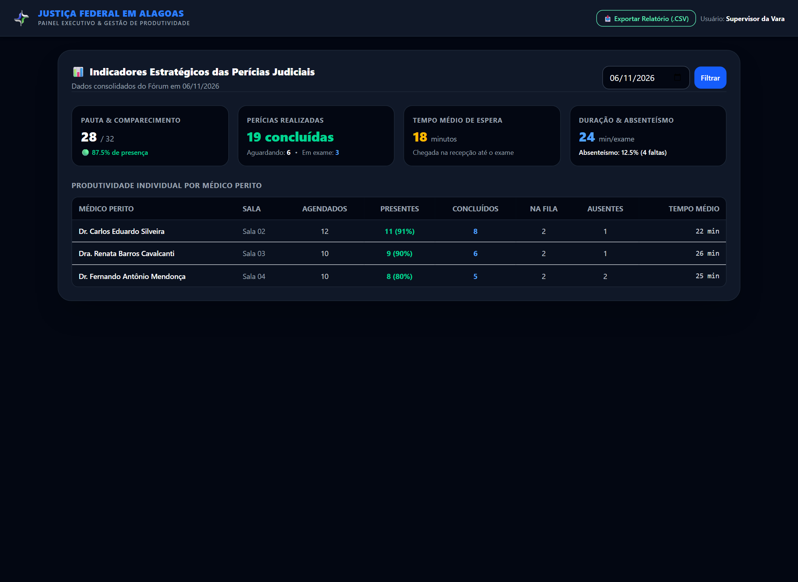
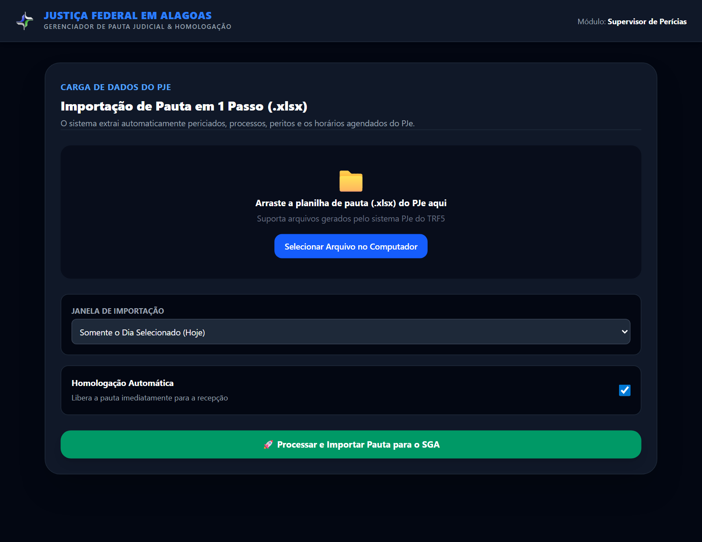
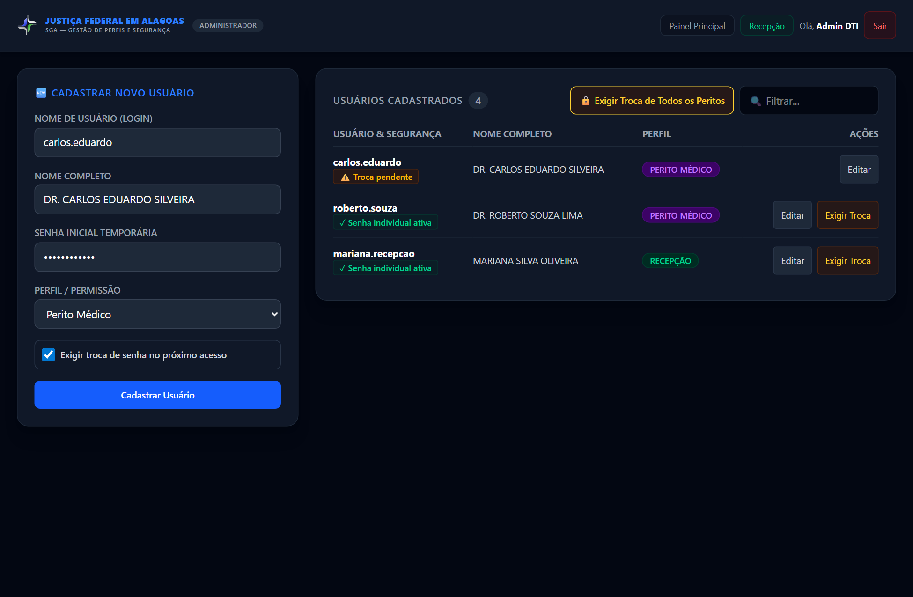

# Manual do Usuário — Gestão, Supervisão e Auditoria
### Sistema de Gerenciamento de Atendimento Pericial (SGA)
**Justiça Federal em Alagoas — Seção Judiciária de Alagoas**

---

## 1. Visão Geral do Perfil Supervisor / Administrador

O módulo de **Supervisão e Gestão** do SGA disponibiliza aos gestores judiciais, supervisores de atendimento e equipes técnicas da DTI ferramentas avançadas para:
- Monitoramento em tempo real da sala de espera, fluxo de check-in e produtividade médica.
- Carga e homologação de pautas de perícias extraídas diretamente do sistema **PJe**.
- Gestão de consultórios físicos e parametrização de salas.
- Controle rigoroso de segurança, perfis de usuários e imposição de troca de senhas iniciais.
- Extração de relatórios analíticos em planilha eletrônica (CSV) para auditoria institucional.

---

## 2. Dashboard Executivo em Duas Abas Estratégicas

O Dashboard do Administrador e Supervisor (`dashboard.php`) foi organizado em uma estrutura moderna de **Duas Abas**, separando a operação diária das análises gerenciais:

1. **🏛️ Aba Módulos Principais (Visão Padrão):**
   - Apresenta os cartões de acesso direto a todos os subsistemas autorizados para o perfil: *Recepção*, *Painel do Perito*, *Painel da TV*, *Gestão de Pautas*, *Salas de Atendimento*, *Auditoria* e *Perfis & Senhas*.
   - A barra superior conta com navegação uniforme e visualmente contrastada em todos os módulos, com destaque para a seção ativa.

2. **📊 Aba Métricas & Produtividade:**
   - Reúne os indicadores em tempo real (KPIs), seletor de data da pauta, botão de exportação executiva em planilha CSV e a tabela consolidada de produtividade por médico perito (agendados, presentes, concluídos, na fila, ausentes e tempo médio de exame).



### Indicadores Estratégicos (KPIs):
- **📋 Total Agendado:** Volume global de perícias judiciais designadas para a data.
- **🕒 Aguardando Chegada:** Quantidade e percentual de periciados que ainda não se apresentaram à recepção.
- **🎟️ Presentes (Check-in):** Quantidade e percentual de periciados que já compareceram ao balcão e retiraram senha.
- **🟢 Em Atendimento:** Consultórios clínicos com exame pericial em andamento neste instante.
- **✓ Concluídos:** Perícias finalizadas no dia e percentual de conclusão da pauta.
- **⏱️ Tempo Médio de Espera:** Intervalo médio transcorrido entre a emissão da senha na recepção e o início do exame pericial.
- **⏱️ Duração Média da Perícia:** Tempo médio de permanência dos cidadãos dentro dos consultórios médicos.

---

## 3. Monitoramento das Salas Periciais e Critérios Médicos

No card **Ocupação das Salas e Critérios Médicos**, a supervisão visualiza detalhadamente o estado operacional de cada consultório:

| Sala | Médico Perito | Status Clínico | Critério de Fila Ativo | Prioridade Legal |
| :--- | :--- | :--- | :--- | :--- |
| **Sala 01** | Dr. Roberto Souza | `🟢 Em Exame (PE-01)` | 🕒 Horário PJe | ⚪ Pura |
| **Sala 02** | Dr. Carlos Eduardo | `🔵 Chamando (PE-02)` | 🏃 Chegada | 🟢 Prioridade Ativada |
| **Sala 03** | Dra. Amanda Vasconcelos | `⚪ Disponível` | 🏃 Chegada | ⚪ Pura |

> [!NOTE]
> Essa visibilidade permite à equipe de recepção e aos supervisores orientar periciados e advogados com precisão absoluta sobre a previsão de chamada e a regra adotada por cada perito.

---

## 4. Auditoria, Estatísticas e Exportação de Relatórios

Para fins de prestação de contas, estatísticas do CNJ e auditoria correcional da Corregedoria-Geral do TRF5:

1. No topo do Dashboard, selecione a **Data da Pauta** desejada (ou filtre pelo médico perito específico).
2. Clique no botão verde **📥 Exportar Relatório do Dia (CSV)**.
3. O SGA gera um arquivo estruturado contendo:
   - Número do processo judicial (com máscara).
   - Nome completo e CPF do periciado.
   - Nome e matrícula do médico perito responsável.
   - Horários precisos de: Agendamento PJe, Chegada/Check-in, Chamada na TV, Início do Exame e Conclusão.
   - Tempo total de espera e tempo de exame clínico calculados.
   - Classificação de prioridade legal concedida.

---

## 5. Carga e Homologação de Pautas do PJe (.xlsx)

O SGA integra-se nativamente aos relatórios de agendamento de perícias do sistema PJe da 5ª Região:



### Passo a Passo da Importação:
1. **Extração no PJe:** No sistema PJe, exporte o relatório da pauta de perícias no formato de planilha Excel (`.xlsx`).
2. **Acesso ao Módulo:** No menu do SGA, acesse **📅 Gestão de Pautas / Importar Pauta**.
3. **Seleção do Arquivo:**
   - Arraste o arquivo `.xlsx` para a área de upload tracejada ou clique em **Selecionar Arquivo no Computador**.
4. **Definição da Janela de Importação:**
   - `Somente o Dia Selecionado (Hoje)`: Recomendado para cargas diárias matinais.
   - `Próximos 3 Dias`: Para adiantar agendamentos de feriados ou fins de semana.
   - `Mês Inteiro`: Para carga massiva de mutirões previdenciários e assistenciais.
5. **Homologação da Pauta:**
   - Deixe marcada a opção **Homologação Automática** se desejar que a recepção comece a atender imediatamente os periciados assim que o upload for concluído.
   - Caso prefira conferir a lista antes de liberar aos balcões, desmarque a opção e clique em **Homologar** manualmente na listagem.
6. **Processamento:**
   - Clique no botão verde **🚀 Processar e Importar Pauta para o SGA**.
   - O sistema valida a consistência de CPF, número de processo, nomes e horários, informando um resumo com a quantidade de perícias importadas com sucesso.

> [!TIP]
> O SGA possui mapeamento flexível de cabeçalhos de colunas, aceitando automaticamente variações como "Nome da Parte", "Autor", "Periciado", "Processo Judicial" e "Número do Processo".

---

## 6. Monitoramento da Sala de Espera e Painel TV

O painel de TV (`painel.php`) é o canal direto de comunicação visual e sonora com os jurisdicionados presentes na sala de espera do Fórum.


### Recomendações Técnicas para a TV:
- **Dispositivo:** Smart TV ou computador conectado a monitor via cabo HDMI/rede local.
- **Navegador:** Iniciar o navegador em modo tela cheia (tecla **F11**).
- **Áudio:** Assegurar que as caixas acústicas da recepção ou os alto-falantes da TV estejam ligados com volume audível. O sistema utiliza a API nativa Web Speech para sintetização de voz em português claro e toques de campainha de alta frequência.
- **Histórico Lateral:** O painel mantém permanentemente visíveis as últimas 5 senhas chamadas com indicação do médico e da sala, permitindo ao cidadão conferir mesmo após o término do aviso sonoro.

---

## 7. Gestão de Perfis, Credenciais e Segurança

O módulo **Perfis & Senhas** (`usuarios.php`) é restrito a administradores e permite gerenciar as credenciais institucionais com rigorosa conformidade às diretrizes de segurança da informação:



### Funcionalidades de Segurança:
1. **Status de Ativação Visível:**
   - `⚠️ Troca pendente`: Identifica usuários que ainda estão utilizando credenciais provisórias ou padrão e precisam definir nova senha.
   - `✓ Senha individual ativa`: Identifica profissionais que já criaram sua senha individual criptografada.
2. **Forçar Troca Individual (Botão "Exigir Troca"):**
   - Em caso de redefinição de credencial ou necessidade de segurança, o supervisor/administrador clica em **Exigir Troca**. O sistema marca imediatamente a conta como pendente de troca e **revoga todas as sessões ativas do usuário**.
3. **Forçar Troca Coletiva de Peritos ("🔒 Exigir Troca de Todos os Peritos"):**
   - Com apenas um clique, o administrador impõe que **100% dos médicos peritos cadastrados** troquem obrigatoriamente de senha no seu próximo login. Essa ação é ideal no início de novas gestões ou após cargas massivas de credenciais provisórias.
4. **Cadastro e Edição com Troca Padrão:**
   - O formulário traz a caixa **"Exigir troca de senha no próximo acesso"** habilitada por padrão, garantindo que nenhum usuário novo permaneça com senhas temporárias de criação.

---

## 8. Rotina Diária Recomendada para o Supervisor

Para garantir a excelência operacional do atendimento pericial, recomenda-se a seguinte rotina diária:

```
[ 07:45 ] - Carga e Homologação da Pauta do Dia (.xlsx do PJe)
    │
[ 08:00 ] - Abertura da TV na Recepção (F11 + Conferência do Som)
    │
[ 08:30 ] - Verificação da Entrada dos Médicos e Ocupação de Salas
    │
[ 12:00 ] - Análise Intermediária no Dashboard (Tempos de Espera e Fila)
    │
[ 17:00 ] - Fechamento Operacional: Exportação do Relatório CSV do Dia
```

### Planos de Contingência:
- **Médico necessita trocar de consultório:** Oriente o perito a clicar em **Trocar de Sala** no seu painel. A sala anterior fica livre de imediato.
- **Periciado convocado com urgência:** A recepção pode registrar o check-in e a prioridade legal; o perito pode puxá-lo ao topo com um clique na chave de prioridade.
- **Falha de rede local momentânea:** Os dados ficam salvos com segurança no banco de dados central; assim que a conexão se restabelecer, o sistema retoma o estado exato da fila.

---
*Manual homologado para o SGA JFAL — Seção Judiciária de Alagoas — Versão 2.4*
